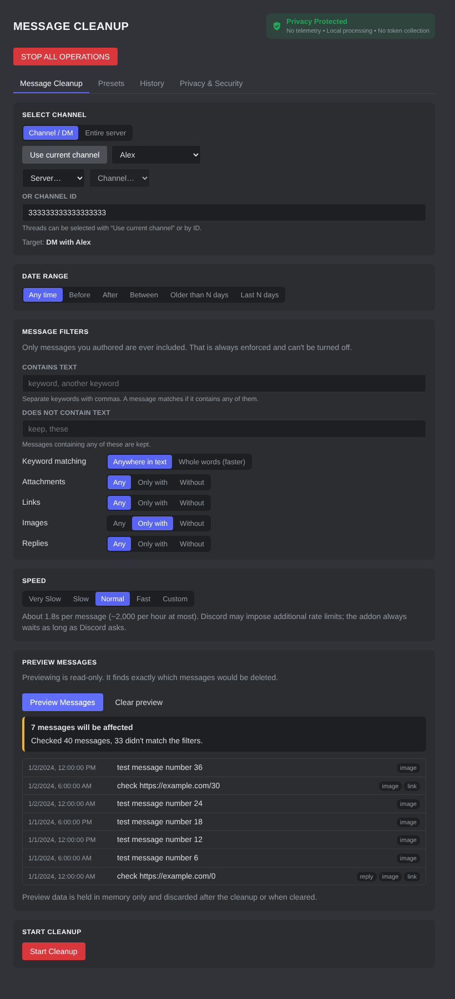
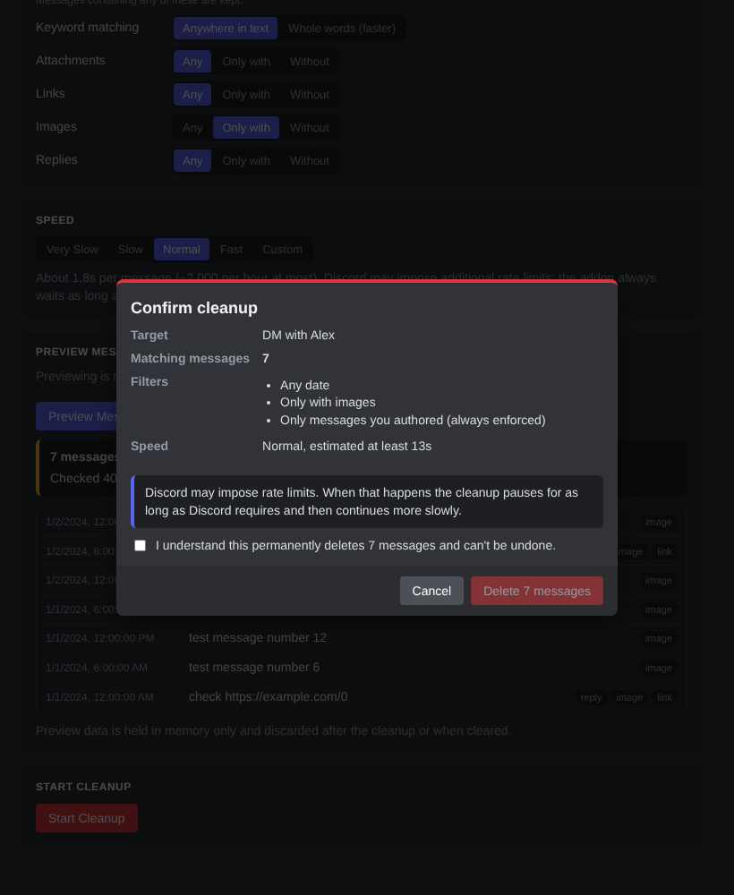
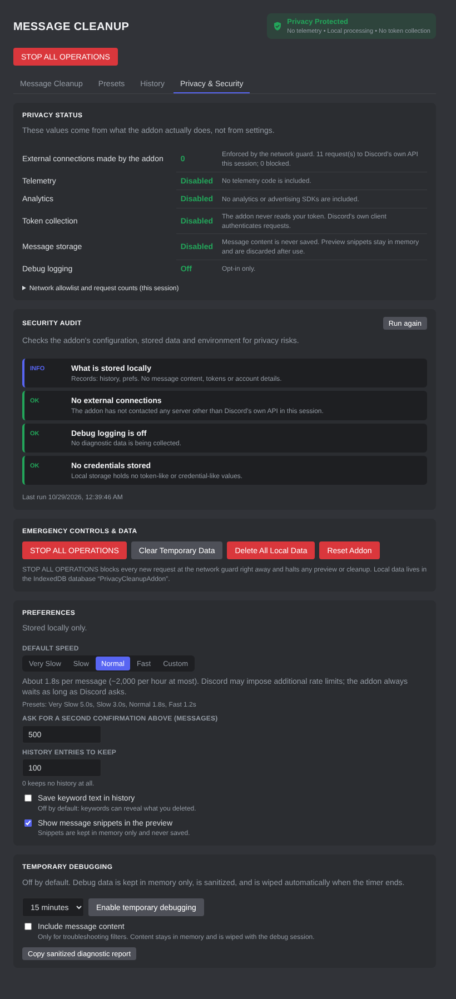

# PrivacyCleanup

A privacy-first [Vencord](https://vencord.dev) userplugin for previewing and deleting **your own** Discord messages, with much stronger local privacy guarantees than the stock client.

- **Message Cleanup**: choose a DM, group DM, channel, thread or whole server; filter by date, text, attachments, links, images and replies; preview exactly what matches; confirm; then pause, resume or cancel while it runs.
- **Privacy & Security**: no telemetry, no analytics, no external connections, no token access. Includes a live Privacy Status panel, a Security Audit, emergency controls, and one-click deletion of all local data.

| Cleanup | Confirmation | Privacy & Security |
|---|---|---|
|  |  |  |

<sub>Screenshots are from a local test harness with fake data.</sub>

> [!WARNING]
> **Discord's Terms of Service don't allow client modifications or automating a user account,** and that includes bulk-deleting your own messages. Discord has no official bulk-delete feature for users.
> This plugin sends the same single-message requests the Discord client sends when you delete by hand, at a deliberately slow pace, and it always honors Discord's rate limits. Your account could **still** be flagged or restricted.
> Deleted messages **can't be recovered**. You must acknowledge this notice in the plugin before your first cleanup.

## Install

You need a local Vencord checkout built from source ([Vencord docs: installing from source](https://docs.vencord.dev/installing/)).

```bash
git clone <this repo> privacy-cleanup
```

```bash
node privacy-cleanup/scripts/install-plugin.mjs /path/to/Vencord
```

```bash
cd /path/to/Vencord && pnpm build && pnpm inject
```

Restart Discord, enable **PrivacyCleanup** under *Vencord → Plugins*, then open **Settings → Message Cleanup**. The full panel is also under the plugin's settings button.

The install script only copies `index.tsx`, `style.css` and `src/` into `Vencord/src/userplugins/privacyCleanup`. It makes no network requests.

## How a cleanup works

1. **Select** a target: the current channel, a DM, a server channel, a channel ID, or an entire server.
2. **Filter** (optional): date range (before / after / between / older than N days / last N days), contains text, does not contain text, and any / only / without for attachments, links, images and replies.
3. **Preview**: a read-only scan with Discord search (`author_id` = you). Every result is re-checked locally, so the count shown is exactly what will be processed. If search isn't available for a channel, the plugin falls back to reading channel history page by page and keeps only your messages.
4. **Confirm**: the dialog shows the target, the number of matching messages, the filters, the speed and a rate-limit notice, and asks you to acknowledge that deletion is permanent. Above your large-operation threshold (default 500) you also have to type the message count.
5. **Run**: messages are deleted one at a time, with live progress (processed / deleted / skipped / rate-limit pauses / errors / estimated time) and Pause, Resume and Cancel buttons.

Changing the selection after a preview invalidates it, and previews expire after 15 minutes. Speed can be changed after previewing.

### Speed

| Preset | Delay between deletions |
|---|---|
| Very Slow | 5.0 s |
| Slow | 3.0 s |
| Normal | 1.8 s |
| Fast | 1.2 s |
| Custom | 1.0 s minimum |

On HTTP 429 the engine waits **at least** Discord's `retry_after` plus a buffer, counts a rate-limit pause, and slows down by 1.5×. It speeds back up gradually (never below your chosen pace) after a run of successes. After 10 rate limits in a row on one message, or 5 consecutive failed messages, it stops instead of pushing on. Rate limits are never bypassed.

### Safety invariants (checked for every message)

- The message's author is the account that made the preview. **Other users' messages are never deleted**, and never kept: during a history-fallback scan they are discarded immediately.
- The logged-in account hasn't changed since the preview. If it has, the cleanup stops.
- STOP ALL OPERATIONS isn't engaged.
- Only message types a user can delete as the author (default messages and replies) are included. System messages are excluded and counted.
- Messages that are already gone (404) or not deletable (403, archived/locked threads) are skipped, not retried.

## Privacy model

| Guarantee | How it's enforced |
|---|---|
| **External connections: 0** | Every request goes through `src/privacy/networkGuard.ts`, an allowlist of exactly four relative Discord API routes (search channel, search server, read channel history, delete a message), all sent through Discord's own REST module. Anything else (absolute URLs, other routes, other methods, unexpected query parameters) is refused and counted. The Privacy Status panel reads from this live ledger. |
| **No token access** | The plugin never reads the token. Discord's REST module adds authentication internally. Responses are reduced to `status`, `body` and `retry-after` before anything else sees them. |
| **No telemetry, analytics or ads** | None included. `tests/staticAudit.test.ts` fails the build if the source contains `fetch(`, XHR, WebSocket, `sendBeacon`, `eval`, `new Function`, dynamic `import()`, remote URLs, CSS `@import`, cookie or token access, or `console.log`. |
| **No remote code** | Nothing is downloaded or executed at runtime. No dependencies ship with the plugin. |
| **No message storage** | Only the records below are ever persisted. Preview results (IDs plus optional short snippets) stay in memory and are discarded after the cleanup, on Clear Temporary Data, or when the plugin is disabled. |
| **Credential-safe storage** | Every storage write is scanned for token-like or credential-like data and **refused** if any is found. The refusal is raised as a visible security alert, never swallowed. |
| **Sanitized logs** | Console output is warnings and errors only, run through a sanitizer that redacts tokens, auth headers, emails, long secrets and URL query strings, and drops sensitive keys. Message content is never logged unless you turn on temporary content debugging. |
| **Opt-in, temporary debugging** | Debug entries live in an in-memory ring buffer, turn off automatically after 5 to 60 minutes, and are wiped when they do. Nothing is written to disk. The "Copy diagnostic report" button also redacts IDs and only copies to your clipboard. |

### What is stored locally

All data lives in a dedicated IndexedDB database, `PrivacyCleanupAddon`, on your machine:

| Key | Contents |
|---|---|
| `prefs` | Risk-notice acknowledgement time, default speed, large-operation threshold, history retention, two privacy toggles, last open tab |
| `presets` | Name, description, filters, date rule, optional speed. Never a channel. |
| `history` | Start/end time, target channel/server **ID**, filter summary (keyword *counts* unless you opt in to saving keyword text), speed, counts, status. Channel names are looked up live and not stored. |

Never stored: message content, message IDs, tokens, passwords, cookies, or account details.

### Emergency controls

- **STOP ALL OPERATIONS** (always visible): engages a kill switch that the network guard checks before **every** request, aborts any wait in progress, and halts the preview and cleanup. Stays engaged until you click *Re-enable operations*.
- **Clear Temporary Data**: discards preview results and snippets, the cleanup form, and all debug data.
- **Delete All Local Data**: empties and then deletes the plugin's database.
- **Reset Addon**: stops everything, clears temporary data, deletes all local data, and restores every default, including the risk notice. (Vencord itself still remembers whether the plugin is enabled.)

### Security Audit

The Privacy & Security tab runs checks for: external or blocked connections, security alerts raised this session, debug mode (and whether it includes content), credential-like values in storage, unrecognized stored records, keyword-saving and history retention settings, preview data held in memory, missing Discord modules, and whether `fetch`/`XMLHttpRequest` have been wrapped by another script. (Discord's own Sentry error reporting does this; Vencord's *NoTrack* plugin turns it off.)

## Architecture

```
index.tsx                 Vencord entry point (start/stop)
style.css                 Scoped styles (Vencord managedStyle; removed automatically on disable)
src/
  app.ts                  Controller: all state and actions, one instance while enabled
  cleanup/                Filters, date rules, speed, search queries, scanner, deletion engine, presets
  discord/
    compat.ts             ← the ONLY file that touches Discord/Vencord internals
    api.ts                Typed access to the 4 allowed routes + response classification
    messages.ts, snowflake.ts, types.ts
  privacy/                Network guard, request ledger, privacy status
  security/               Sanitizer, credential detection, logger, kill switch, audit, reports
  storage/                IndexedDB adapter, schema + validation, local store
  ui/                     React components (plain elements styled with Discord theme variables)
  utils/
tests/                    Vitest suites, including the static privacy audit
typings/                  Type shims for standalone type-checking (not copied into Vencord)
```

**Compatibility:** everything Discord-specific sits behind `src/discord/compat.ts`. Each store access is guarded. If a Discord update removes a module, the dependent feature turns off, the Security Audit names it, and the UI tells you; nothing is patched or worked around. The plugin adds no webpack patches and no global hooks. The UI uses only Discord's React and theme CSS variables, not Discord's internal UI components, so component renames don't break it. `stop()` halts any running operation, removes the settings entry, drops every subscription and timer, and clears in-memory data.

## Development

```bash
npm install
```

```bash
npm run check
```

`npm run check` type-checks under strict TypeScript and runs the test suite: filters, sanitizer, network guard, deletion engine, scanner, the app controller end to end with a fake Discord, and the static privacy audit. The plugin has also been verified to build and type-check inside a current Vencord checkout.

## Known limitations

- Discord search can take a while to index older messages; the preview waits when Discord says so (HTTP 202).
- One preview is capped at 50,000 matching messages to keep memory bounded. Run another pass for the rest.
- Messages in channels you can no longer access, or in archived or locked threads, can't be deleted and are skipped.
- "Whole words" keyword matching uses Discord search for single keywords and is faster. "Anywhere in text" checks every one of your messages locally and is exhaustive.
